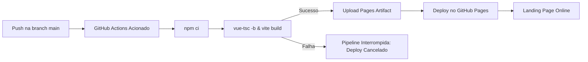

# 🚀 Deploy Automático no GitHub Pages — AgendeFácil

Este documento descreve a configuração e o funcionamento da pipeline de Integração e Entrega Contínua (CI/CD) para publicação automática da landing page do **AgendeFácil** no **GitHub Pages** via **GitHub Actions**.

---

## 📋 Sumário
1. [Visão Geral do Fluxo](#visão-geral-do-fluxo)
2. [Configuração no GitHub](#configuração-no-github)
3. [Compatibilidade com Vite e Vue.js](#compatibilidade-com-vite-e-vuejs)
4. [Domínio Personalizado (Custom Domain)](#domínio-personalizado-custom-domain)
5. [Segurança e Permissões](#segurança-e-permissões)
6. [Testes e Validação Local](#testes-e-validação-local)

---

## 1. Visão Geral do Fluxo

A publicação é gerenciada pelo workflow [deploy.yml](file:///.github/workflows/deploy.yml).



### Regras do Pipeline:
- **Gatilhos:** Qualquer `push` na branch `main` ou disparo manual via aba **Actions** (`workflow_dispatch`).
- **Bloqueio de Falhas:** O job `deploy` só executa se o job `build` for concluído com sucesso (`needs: build`). Erros de TypeScript ou Vite interrompem a pipeline antes de qualquer publicação.
- **Concorrência Segura:** Configurado com `concurrency: group: pages, cancel-in-progress: false` para evitar deploys simultâneos conflitantes.

---

## 2. Configuração no GitHub

Para que o GitHub Pages receba os deploys do GitHub Actions, realize a configuração inicial no repositório:

1. Acesse seu repositório no GitHub: `https://github.com/chgyn/site-public-agendamento`.
2. Vá em **Settings** > **Pages** (no menu lateral esquerdo).
3. Na seção **Build and deployment**:
   - Em **Source**, selecione: **`GitHub Actions`**.
4. Pronto! O GitHub Pages estará habilitado para receber os artefatos enviados pela pipeline.

Após o primeiro push ou disparo manual, a URL padrão do projeto será:
👉 **`https://chgyn.github.io/site-public-agendamento/`**

---

## 3. Compatibilidade com Vite e Vue.js

O Vite foi configurado em [vite.config.ts](file:///vite.config.ts) para resolver corretamente os caminhos relativos ao subdiretório do repositório:

```typescript
// vite.config.ts
export default defineConfig({
  plugins: [vue()],
  base: (() => {
    const rawBase = process.env.BASE_PATH
    if (rawBase !== undefined && rawBase !== '') {
      return rawBase.endsWith('/') ? rawBase : `${rawBase}/`
    }
    return process.env.GITHUB_ACTIONS ? '/site-public-agendamento/' : '/'
  })(),
})
```

### Destaques de Compatibilidade:
1. **Subdiretório `/site-public-agendamento/`:**
   - Em ambiente CI (`GITHUB_ACTIONS=true`), o base URL é configurado automaticamente como `/site-public-agendamento/`.
   - Scripts (`.js`), estilos (`.css`), favicons e imagens do diretório `public/` recebem o prefixo correto no build de produção.
2. **Ambiente Local (`npm run dev` / `npm run build`):**
   - O base URL padrão permanece `/`, garantindo que o desenvolvimento local não seja afetado.
3. **Resolução de Imagens no Componente Hero:**
   - As imagens dinâmicas utilizam `import.meta.env.BASE_URL`, garantindo que nunca quebrem independentemente do subdiretório de deploy.
4. **Fallback 404 para SPAs:**
   - Durante a pipeline, uma cópia de `dist/index.html` é gerada como `dist/404.html`. Isso garante que acessos diretos com barras ou rotas não retornem tela de erro padrão do GitHub.

---

## 4. Domínio Personalizado (Custom Domain)

O projeto está configurado para o domínio personalizado:
👉 **`https://agendefacil.charlesegidio.space/`**

### 4.1. Arquivo CNAME
O repositório possui o arquivo `public/CNAME` contendo `agendefacil.charlesegidio.space`. Durante o build do Vite, ele é copiado para `dist/CNAME` e publicado automaticamente no GitHub Pages, garantindo que o domínio permaneça vinculado a cada deploy.

### 4.2. Apontamento de DNS
- Para subdomínios (ex: `agendefacil.charlesegidio.space`):
  - Crie um registro **CNAME** apontando para: `chgyn.github.io.`
- Para domínio raiz (Apex):
  - Crie registros do tipo **A** apontando para os IPs do GitHub Pages (`185.199.108.153`, etc.).

### 4.3. Configuração no GitHub
1. Vá em **Settings** > **Pages** > **Custom domain**.
2. Digite o domínio `agendefacil.charlesegidio.space` e clique em **Save**.
3. Marque a opção **Enforce HTTPS**.

### 4.4. Caminho Base na Publicação
Com um domínio personalizado, o site é servido a partir da raiz (`/`) em vez do subdiretório `/site-public-agendamento/`.
- O workflow do GitHub Actions captura automaticamente o `base_path` via `actions/configure-pages@v5` (que retorna `""` para domínios próprios).
- O `vite.config.ts` trata caminhos vazios gerando todos os assets sob `/assets/...`, evitando erros 404 e tela em branco.

---

## 5. Segurança e Permissões

O workflow segue o princípio de menor privilégio (least privilege):

```yaml
permissions:
  contents: read      # Leitura restrita do código-fonte
  pages: write         # Permissão para publicar no GitHub Pages
  id-token: write      # Permissão OIDC para autenticação do deploy
```

- Nenhum token pessoal (PAT) ou segredo confidencial precisa ser adicionado ou armazenado no repositório.
- Utiliza os componentes oficiais da equipe do GitHub:
  - `actions/checkout@v4`
  - `actions/setup-node@v4`
  - `actions/configure-pages@v5`
  - `actions/upload-pages-artifact@v3`
  - `actions/deploy-pages@v4`

---

## 6. Testes e Validação Local

Antes de enviar commits para a branch principal, você pode simular a compilação de produção localmente:

```bash
# 1. Simulação do build padrão local (base: /)
npm run build

# 2. Simulação do build do GitHub Pages (base: /site-public-agendamento/)
GITHUB_ACTIONS=true npm run build

# 3. Pré-visualizar os arquivos gerados
npm run preview
```
